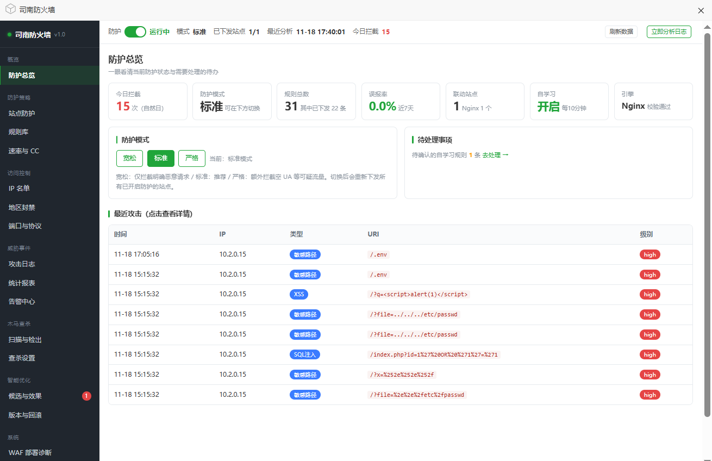
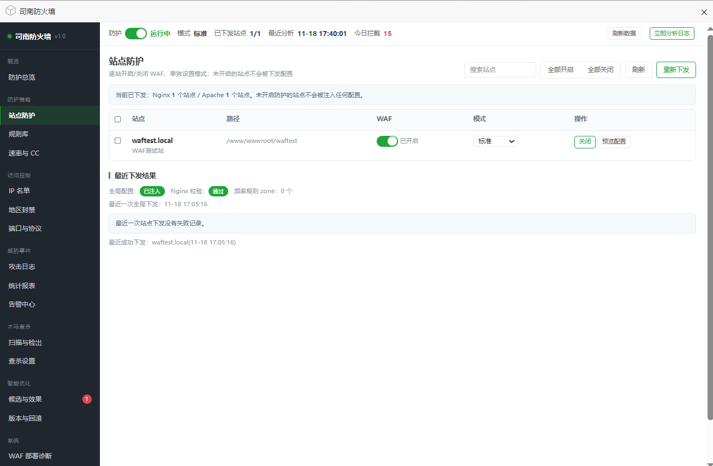
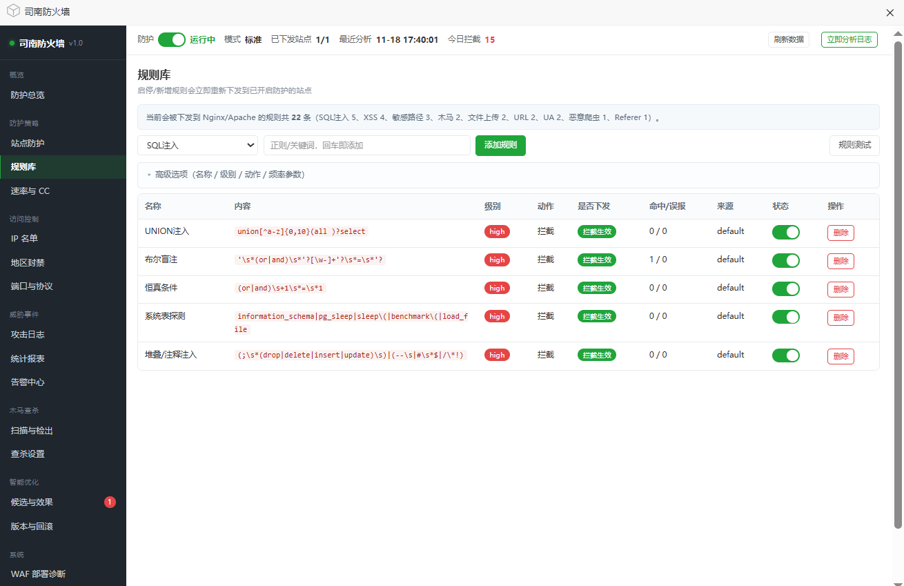
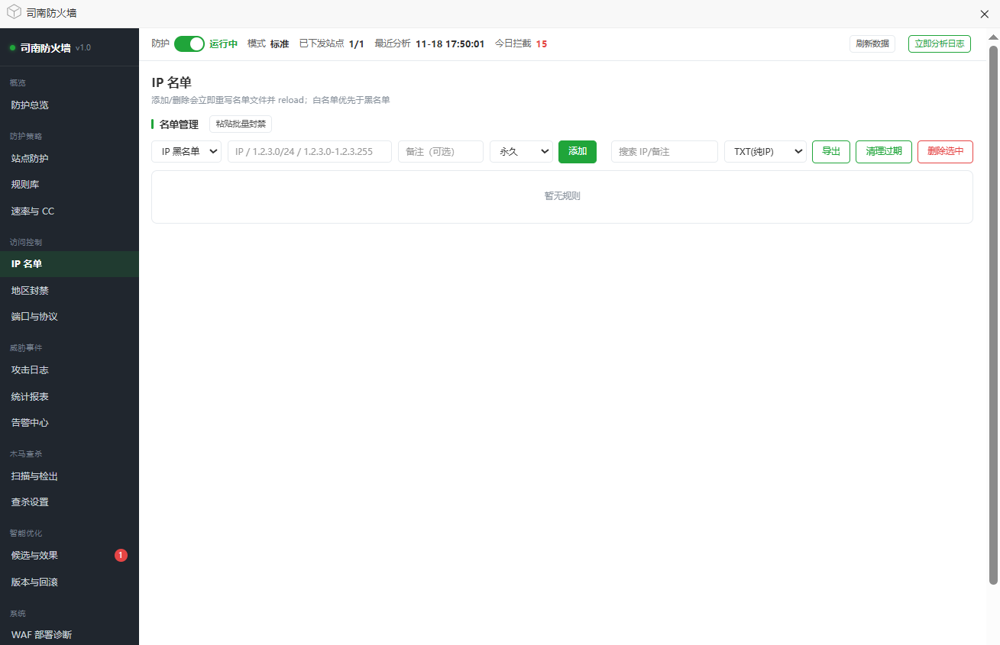
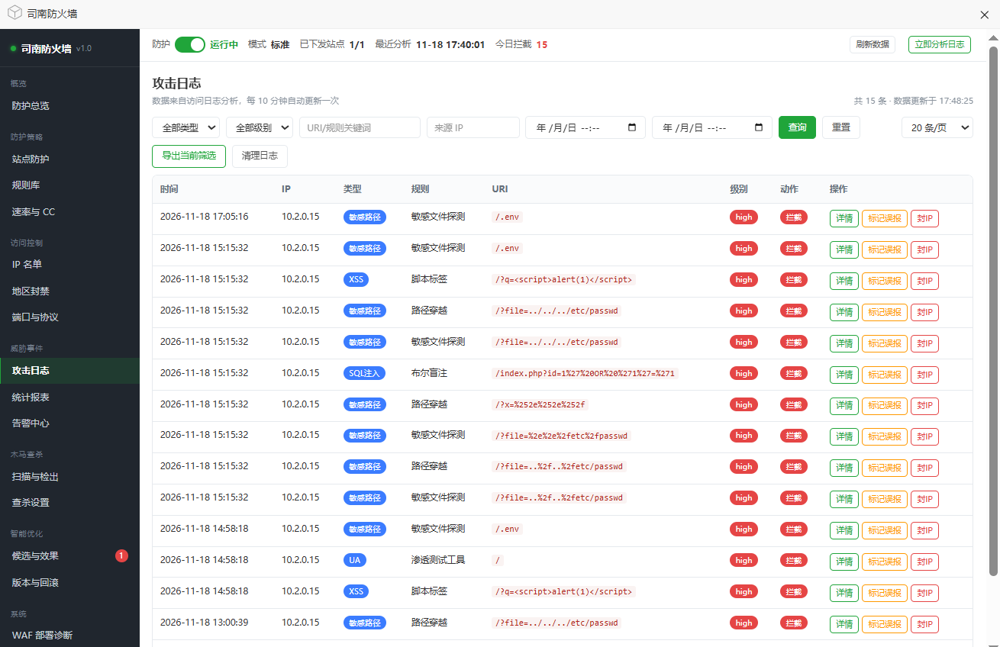
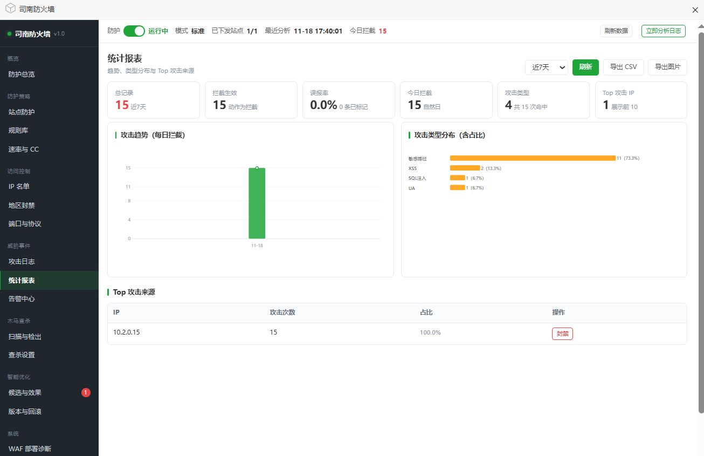
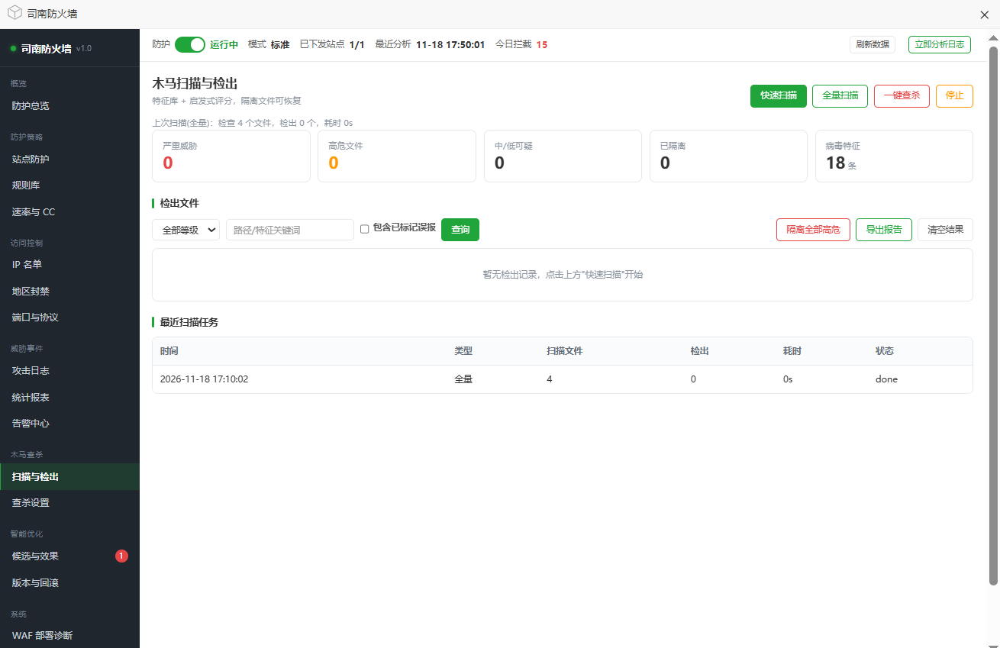
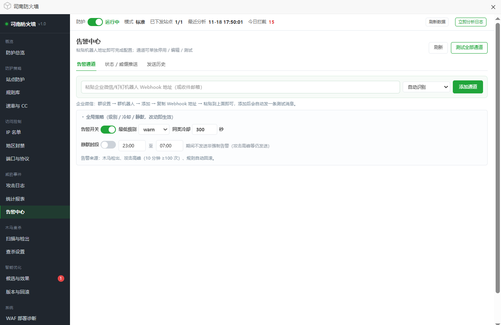
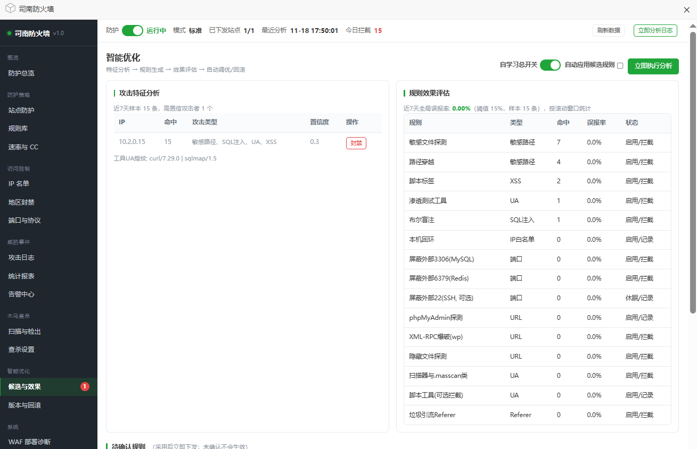

<div align="center">

# 司南防火墙 SinanWAF

**为宝塔面板打造的全功能网站防火墙（WAF）插件**

Nginx / Apache 原生指令 · 31 条出厂规则 · WebShell 查杀 · 递归自学习 · 多通道告警

[](LICENSE)
[](sinanwaf/info.json)
[](sinanwaf/info.json)
[](sinanwaf/install.sh)

[功能详解](#功能详解) · [界面预览](#界面预览) · [安装与卸载](#安装与卸载) · [本地测试](#本地测试windows无需宝塔) · [常见问题](#常见问题)

</div>



## 一键下载与导入

> 💡 **无需克隆仓库**，直接下载下方一键包，导入宝塔面板即可使用（包内已含全部源码与 GPL-3.0 LICENSE）。

| 平台 | 下载地址 |
|---|---|
| GitHub | <https://github.com/gtmaker520/sinan-waf/raw/main/sinanwaf.zip> |
| AtomGit | <https://atomgit.com/api/v5/repos/gtmaker/sinan-waf/raw/sinanwaf.zip?ref=main> |

**导入步骤**：

1. 打开宝塔面板 → 软件商店 → 第三方应用 → **导入插件**；
2. 上传 `sinanwaf.zip`，导入后面板自动注册插件；
3. 点击 **安装**，等待脚本完成运行目录创建、规则库初始化、Nginx/Apache 全局配置下发与计划任务注册；
4. 打开「司南防火墙」，在站点防护中对目标站点一键开启防护。

## 简介

> 📌 本项目基于 [Peteliao/btfirewall](https://github.com/Peteliao/btfirewall)（GPL-3.0）二次开发并更名为「司南防火墙 SinanWAF」，感谢原作者 fhq 的贡献。

**司南防火墙（SinanWAF）** 是一个面向[宝塔面板](https://www.bt.cn/)的网站防火墙插件。它把 **WAF 防护、IP 访问控制、CC/暴力破解防护、WebShell 查杀、攻击日志分析、告警推送、规则自学习** 整合进一个可视化面板，安装后即可在宝塔中管理。

与 OpenResty / ModSecurity / Lua 方案不同，本插件基于 **Nginx/Apache 原生指令 + 访问日志智能分析** 实现：

- **零第三方依赖**：只用 Python 标准库（兼容面板内置 Python 2.7 ~ 3.12）与 SQLite；
- **无 Lua / ModSecurity**：不需要额外编译模块，不改变现有 Web 环境；
- **无长驻进程**：仅一个每 10 分钟执行一次的计划任务，资源占用低；
- **双重安全兜底**：所有配置改动先备份、再 `nginx -t` / `httpd -t` 校验，失败自动回滚，避免把站点改挂。

> 当前版本：**1.0.0**（SinanWAF 首个发行版），已适配宝塔面板 **7.9 ~ 13.2**（7.x / 8.x / 9.x / 10.x / 11.x / 12.x / 13.x）。
>
> 📜 上游历史版本（1.6.x 及更早）为原项目 btfirewall 的更新记录，见下方保留条目。

**适合谁：** 个人站长、中小企业运维，以及希望在宝塔面板里获得可视化 WAF，又不想引入 OpenResty/ModSecurity 的用户。

**不适合谁：** 需要 GeoIP 精确国家级拦截、需要 ModSecurity CRS 级别语义分析，或需要多机集群统一防护的场景。

---

## 核心特性

| 模块 | 能力 |
|---|---|
| 防护总览 | 状态卡片、一键启停、宽松/标准/严格三模式、待办提醒、最近攻击、全局状态条 |
| 站点防护 | 逐站开关 WAF、独立模式、批量开关、配置预览、下发报告、失败重试 |
| 规则库 | 14 类规则、31 条出厂配置、快速添加、规则测试器、下发预览、导入导出 |
| 访问控制 | IP 黑白名单、CIDR/区间、临时封禁、粘贴提取、批量封禁、分页搜索、TXT/CSV/JSON 导出 |
| 地区封禁 | 国家代码规则、内置常用网段表、`custom_region.json` 扩展 |
| 端口与协议 | 端口暴露防护、预演、iptables 下发（默认关闭，保护端口强制跳过） |
| 速率与 CC | 全局限速、并发限制、CC 阈值自动封禁、静态资源/自定义 URL 豁免、按 URI 独立限速 |
| 攻击日志 | 增量分析、行内时间入库、多条件筛选、详情抽屉、误报标记、一键封 IP、导出 |
| 统计报表 | 24 小时 / 7 天 / 30 天趋势、类型分布、Top 攻击 IP、CSV/PNG 导出 |
| 告警中心 | 企业微信 / 钉钉（加签）/ 通用 Webhook / 邮件（SMTP），通道分级、静默时段、冷却、发送历史 |
| 状态与威慑推送 | 定时运行状态推送、拦截威慑战报、Markdown / 纯文本双格式、消息预览 |
| 木马查杀 | MD5 黑名单、18 条内置特征、启发式加权评分、隔离恢复、白名单、定时全量/增量扫描 |
| 智能优化 | 特征分析、规则生成、待确认/自动应用、效果评估、误报率降级、自动回滚 |
| WAF 部署 | Nginx/Apache 双引擎、全局/站点/端口三层、备份校验、幂等标记、失败回滚 |
| 系统管理 | 规则导入导出、快照与文件备份（下载/删除/恢复）、部署诊断、审计日志 |
| 权限管理 | admin / operator / auditor 三角色、面板用户角色映射、敏感字段脱敏、操作审计 |
| 本地测试 | Windows 双击启动沙箱，无需宝塔/Linux，自带 48 项后端自检与演示数据 |

---

## 界面预览

> 截图来自项目自带的 Windows 本地沙箱（演示数据），沙箱路径已替换为生产路径示意。

<p align="center">
  
  
</p>
<p align="center">
  
  
</p>
<p align="center">
  
  
</p>
<p align="center">
  
  
</p>

界面采用**左侧分组导航 + 顶部全局状态条**，17 个页面按使用场景分组；导航项上的红色徽标表示待处理数量（高危木马、待确认规则）。

| 分组 | 页面 |
|---|---|
| 概览 | 防护总览 |
| 防护策略 | 站点防护 / 规则库 / 速率与 CC |
| 访问控制 | IP 名单 / 地区封禁 / 端口与协议 |
| 威胁事件 | 攻击日志 / 统计报表 / 告警中心 |
| 木马查杀 | 扫描与检出 / 查杀设置 |
| 智能优化 | 候选与效果 / 版本与回滚 |
| 系统 | WAF 部署诊断 / 导入导出与备份 / 权限与审计 |

---

## 功能详解

### 1. 防护总览

- **状态卡片**：今日拦截（自然日）、当前防护模式、规则总数与已下发条数、近 7 天误报率、联动站点数、自学习状态、Web 服务器引擎状态。
- **一键启停**：顶部状态条或总览开关即可启停全站防护。启停只重写已被 include 的 WAF 文件并 reload，**不改动用户 vhost 原文**。
- **三种模式**：
  - `宽松`：只拦截明确的恶意请求，适合排查误报；
  - `标准`：推荐模式，默认启用 CC、限速与全部拦截规则；
  - `严格`：在标准基础上额外拦截空 UA 等可疑流量，适合被攻击期间。
- **待办事项**：未处理高危木马、待确认的自学习规则，一键跳转处理。
- **最近攻击**：展示时间、IP、类型、URI、级别，点击可打开攻击详情抽屉。
- **全局状态条**：防护状态、模式、已下发站点、最近分析时间、今日拦截，右侧可「刷新数据」「立即分析日志」。

### 2. 站点防护

- 自动读取宝塔站点列表；**逐个站点**开启/关闭 WAF，并可为每个站点单独选择模式。
- 支持搜索站点、**全部开启 / 全部关闭**、勾选后批量操作；下发失败可**一键重试失败站点**。
- **配置预览**：只读抽屉中查看该站点将要写入的完整 Nginx / Apache 配置、vhost 是否存在、include 是否已注入、当前模式与频率规则数量。
- **下发报告**：展示全局注入状态、`nginx -t` 校验结果、频率 zone 数量、各站点最近一次成功/失败时间与错误原因。
- 未开启防护的站点**不会被隐式注入**配置；关闭后会清理残留 include。
- 站点 WAF 配置下发失败时自动回滚该站点配置并 reload，并在报告中给出明确原因。

### 3. 规则库

内置 **31 条出厂规则/配置**（含 IP 白名单、端口与协议规则），覆盖 14 种规则类型：

| 类型 | 说明 |
|---|---|
| `ip_black` | IP 黑名单（支持 IP / CIDR / 区间 / 临时封禁） |
| `ip_white` | IP 白名单（优先级高于黑名单） |
| `ip_region` | 地区封禁（国家代码） |
| `port_proto` | 端口与协议规则 |
| `url` | URL 关键词/正则过滤 |
| `ua` | User-Agent 过滤 |
| `referer` | Referer 过滤 |
| `sqli` | SQL 注入 |
| `xss` | XSS |
| `upload` | 危险文件上传 / 双扩展名 |
| `trojan` | WebShell / 木马访问特征 |
| `bot` | 恶意爬虫 / 扫描器 |
| `path_scan` | 敏感路径 / 备份文件 / 路径穿越 |
| `freq` | 按 URI 正则独立限速 |

- **出厂规则示例**：UNION 注入、布尔盲注、恒真条件、系统表探测、脚本标签、事件属性、JS 伪协议、上传落地脚本、双扩展名、WebShell 特征、常见木马文件名、渗透工具 UA、SEO 爬虫、敏感文件/备份文件探测、路径穿越、登录暴破联动等。
- **快速添加**：默认只需选择「类型」、填写「内容」回车即可添加；名称、级别、动作、频率参数收在「高级选项」。
- **规则测试器**：输入 IP / URI / UA / Referer 即可验证请求会命中哪些规则，默认跳过白名单 IP 的误导结果。
- **下发预览**：页面顶部显示当前会真正下发的规则条数、按类型统计；每条规则行显示「拦截生效 / 仅记录 / 未启用」；无法下发的规则会列出原因（正则非法、过长、超上限）。
- **动作模式**：`block` 拦截（生成 Nginx `if` / Apache `RewriteCond`）或 `log` 仅记录（参与日志分析，不写拦截指令）。
- **频率规则**：每条规则独立生成 `map + limit_req_zone`，只有命中该 URI 的请求才计数，**不生成 location 块，不影响站点原有路由**；速率与突发可配置。
- **安全校验**：正则入库前做合法性与 ReDoS 防护校验（最长 512 字符），非法规则不会写入 Web 服务器配置。
- **导入导出**：JSON 格式导出；导入支持「合并（跳过重复）/ 覆盖」，导入前做合法性校验，导入后自动重新下发。

### 4. 速率与 CC 防护

- **全局默认**：`20r/s` 限速、突发 40、并发连接 30，可由界面修改并自动下发。
- **CC 防护**：默认 120 次 / 60 秒，超限自动封禁 600 秒；登录接口纳入高频统计，防暴力破解。
- **限速豁免**：Nginx `map $uri $btfw_limit_key` 让**静态资源**（JS/CSS/图片/字体/音视频/压缩包）与**自定义 URL 正则**使用空 key，不计入限速与并发，避免误伤正常访问；最多可配置 50 条豁免正则。
- **按 URI 独立限速**：频率规则可为登录接口等单独设置速率（如 `^/api/login$` 限 `5r/s`、突发 10）。
- 被限流返回 `429`；`宽松` 模式下不启用 CC 与频率限制，`严格` 模式会增加空 UA 拦截。

### 5. IP 名单与快速封禁

- **黑白名单**：黑名单立即重写名单文件并 reload；白名单优先于黑名单，生成 `allow` 放行并跳过日志分析；已封禁 IP 加入白名单后立即解封。
- **网段与区间**：支持单 IP、CIDR（`1.2.3.0/24`）与区间（`1.2.3.0-1.2.3.255`），区间自动折算为**最小 CIDR** 下发。
- **临时封禁**：1 小时 / 24 小时 / 7 天 / 永久；名单显示到期时间，计划任务自动解封并重新下发。
- **粘贴提取**：粘贴攻击日志、表格或聊天记录，自动识别所有 IPv4（含端口、CIDR、区间、URL 中的 IP），去重并过滤非法地址；可切换「封禁整个网段（/24）」或「仅封禁单个 IP」，支持一键复制与批量封禁。
- **名单管理**：**服务端分页 + 服务端搜索**，勾选/全选、批量删除；支持**跨页全选当前筛选结果**并按条件删除；「清理过期」立即处理到期项。
- **导出**：`TXT`（纯 IP，可直接导入其他防火墙）、`CSV`（含级别/动作/来源/命中/时间）、`JSON`，按当前搜索条件导出。
- 任何名单增删改都会重写名单 → 语法校验 → reload，失败时保留原配置继续服务。

### 6. 地区封禁

- 输入国家代码（如 `CN`、`US`、`RU`）创建地区规则；内置常用国家/地区精简网段表，可通过 `/www/server/sinanwaf/rules/custom_region.json` 扩展。
- **重要限制**：当前版本未加载 GeoIP 数据库，地区规则**只写入攻击日志并触发告警，不会在 Nginx/Apache 层直接拦截**（界面已明确提示）。需要真正拦截请使用 IP 网段封禁，或自行安装 GeoIP 模块并在 Nginx 层配置。

### 7. 端口与协议

- 支持如 `3306/TCP`、`6379/TCP` 的端口规则，防止数据库/缓存端口暴露公网。
- **默认不下发系统防火墙**：必须先显式开启「允许下发到系统防火墙」，支持**预演**后再执行。
- 下发后写入 iptables 并尝试持久化；`20/21/22/25/80/443/888/8888/39000` 等端口**永久保护**，避免把自己锁在服务器外。
- 卸载脚本会清理带 `BTFW` 标记的 iptables 条目。

### 8. 攻击日志

- 每 10 分钟增量分析 Nginx/Apache 访问日志；使用**日志行内时间**入库，统计更准确；单轮内去重，避免重复记录。
- **游标断点续读**：记录 inode + 真实文件偏移；日志切割后自动从头读取；首次分析回溯最近 2MB，单轮最多处理 20 万行。
- 支持按类型、级别、来源 IP、时间范围、URI/规则关键词筛选与分页浏览。
- **详情抽屉**：查看 UA、Referer、命中规则、命中内容；可在行内「标记误报 / 撤销误报」「封 IP（1 小时 / 24 小时 / 7 天 / 永久）」。
- **导出**：CSV（时间、IP、站点、URI、规则、类型、级别、动作与命中内容），按当前时间范围与筛选条件导出；攻击日志默认保留 90 天，可配置。
- 支持手动「立即分析日志」与「清理日志」。

### 9. 统计报表

- 时间范围：**24 小时 / 近 7 天 / 近 30 天**。
- **汇总卡片**：总记录、拦截生效、误报、误报率、今日拦截、攻击类型数、Top 攻击 IP。
- **攻击趋势**：带 Y 轴刻度/网格/悬浮数值的趋势图；单日数据自动绘制为柱形。
- **类型分布**：带百分比的可视化分布。
- **Top 攻击来源**：IP、攻击次数、占比，可直接封禁。
- **导出**：`CSV`（汇总 / 趋势 / 类型 / Top IP 分段，可直接进 Excel）与 `PNG` 图片（前端 canvas 合成，适合贴周报）。

### 10. 告警中心

支持四类告警通道：

| 通道 | 说明 |
|---|---|
| 企业微信机器人 | 粘贴 Webhook 地址即可，发送文本消息 |
| 钉钉机器人 | 支持加签（timestamp + HMAC-SHA256），Markdown 消息 |
| 通用 Webhook | POST JSON（title / level / body / time），可对接自建服务 |
| 邮件 | 宝塔内置发信或完整 SMTP 配置（服务器/端口/账号/密码/SSL/发件人） |

- **粘贴即建通道**：粘贴机器人地址后自动识别企微/钉钉/通用，创建后自动发送测试并回显结果。
- **通道级过滤**：每个通道可单独启停、编辑、测试，设置**最低级别**与**接收事件**（攻击 / 木马 / 规则回滚 / 防护摘要），实现「严重告警发群、摘要发邮件」。
- **全局策略**：最低级别、同类告警冷却（默认 300 秒，按归一化标题去重）、**静默时段**（如 23:00–07:00，支持跨零点）。
- **攻击告警**：高频攻击者触发即时告警；10 分钟内攻击 ≥100 次触发攻击高峰告警；每 10 分钟发送防护摘要。
- **发送历史**：逐通道展示成功/失败结果与原因，便于核对。
- 非 admin 角色读取配置时，Webhook 地址、加签密钥、邮箱账号等敏感字段自动脱敏为 `***`。

### 11. 状态 / 威慑推送

在「告警中心 → 状态 / 威慑推送」配置一个独立 Webhook，用于主动汇报运行状态或对外展示拦截威慑。

- **机器人类型**：企业微信机器人 / 钉钉机器人 / 通用 Webhook。
- **消息格式**：
  - **Markdown**：标题、引用、加粗、警示色，企微/钉钉客户端内排版美观；
  - **纯文本**：无任何标记，兼容性最高，可直接转发个人微信或短信网关。
- **触发方式**：
  - 定时状态推送：默认每 6 小时（1~168 可调）；
  - 拦截威慑推送：默认新增 ≥5 条拦截且距上次推送 ≥60 分钟才触发，防止刷屏；
  - 手动推送：立即推送运行状态 / 拦截威慑 / 发送测试；
  - 计划任务每 10 分钟检查一次。
- **状态消息内容**：防护开关与模式、下发站点、今日拦截、涉及 IP、黑白名单数量、主要攻击类型、规则启用数、近 7 天误报率、待确认规则、木马待处理、最近分析与扫描、最近一条拦截。
- **威慑消息内容**：今日拦截次数、来源 IP、封禁名单、主要攻击类型、近 7 天累计、最近拦截详情，并附「攻击已留痕」提示。
- **消息预览**：配置页切换「状态/威慑」与「Markdown/纯文本」即可查看实际发送内容，无需先配置。
- 长度限制：企微 Markdown 约 3800 字、纯文本按 1800 字截断；钉钉填了 Secret 会自动加签；推送记录写入告警历史。

### 12. 木马查杀

多层加权评分，而非单一关键字匹配：

1. **MD5 黑名单**：已知样本哈希直接判定（可导入）；
2. **正则特征库**：内置 **18 条**特征，可按需无限扩展；覆盖一句话木马、`eval(base64_decode(...))`、`preg_replace /e`、中国菜刀/冰蝎/蚁剑、动态函数免杀、`$_FILES` 上传后门、`.user.ini`/`.htaccess` 配置后门、JSP/ASP 木马、远程包含、敏感信息窃取等；
3. **启发式评分**：
   - 用户输入（`$_POST/$_GET/...`）直连危险函数：+25；
   - 多层编码混淆（base64 + gzinflate / str_rot13 / chr）：+15；
   - 超长单行、高熵 Base64 载荷：+10~12；
   - 图片马（图片扩展名内嵌 `<?php` / 执行函数）：+30 / +25；
   - 双扩展名绕过、随机文件名、隐藏脚本：+10~30；
   - 上传目录内出现可执行脚本：+20；24 小时内新增/修改：+5。
4. **等级划分**：`critical ≥ 80 / high ≥ 55 / medium ≥ 30 / low ≥ 15`，低于 15 分视为干净。

**处置闭环：**

```
扫描 → 报告（默认） → 人工复核 → 隔离（可恢复）/ 永久删除 / 标记误报
                       ├─ 高危类型自动生成 path_scan 拦截规则并重新下发 WAF
                       └─ 触发 critical 告警（企微/钉钉/Webhook/邮件）
```

- **隔离区**：`/www/server/sinanwaf/quarantine/`，记录原路径，可一键恢复。
- **白名单**：按文件 MD5 或目录前缀排除误报；标记误报时自动加白，可撤销。
- **扫描方式**：快速扫描（增量）、全量深度扫描、一键查杀（全量 + 自动隔离达阈值文件，需二次确认）。
- **资源控制**：单文件上限 2MB、总文件数上限 6 万、超时 900 秒、每 200 个文件让出 CPU；排除 `node_modules/.git/vendor/cache/logs` 等目录；支持随时停止；文件锁保证手动与定时扫描互斥。
- **定时策略**：计划任务每 10 分钟检查，每天一次全量 + 每小时一次增量；增量索引基于 `mtime + size`。
- **特征库与报告**：界面可粘贴 JSON 数组扩展自定义特征（与内置库分离，升级不丢失）；报告支持 CSV / JSON 导出。
- 默认 `auto_quarantine=false`（只报告不自动移动文件），生产环境建议人工复核后再隔离。

### 13. 递归自我改进（智能优化）

每 10 分钟由计划任务执行一个完整闭环：

```
特征分析 → 规则生成/优化 → 效果评估 → 误报监控 → 自动调优/回滚 → 记录学习轨迹
```

- **特征分析**：统计高频攻击 IP、URI 模式、攻击工具指纹、攻击类型与时段；识别「强攻击者」（多类型 + 高频 + 零误报）。
- **总开关**：智能优化页可关闭自学习，关闭后计划任务不会修改任何规则。
- **规则生成**：
  - `auto_apply=confirm`（默认）：强攻击者 IP、工具 UA、可疑文件扩展名进入**待确认队列**，人工采纳后才下发；
  - `auto_apply=auto`：置信度 ≥0.6 的规则自动入库，并立即写入名单 / reload 生效。
- **规则优化**：命中数 ≥20 且误报率 >15% 的规则自动从「拦截」降级为「仅记录」；30 天零命中的自动规则自动休眠。
- **效果评估**：逐规则展示命中量、误报率、状态；全局误报率按**近 7 天滚动窗口**统计。
- **自动回滚**：窗口内样本 ≥200 且误报率超阈值时，回滚至最近 stable 版本并告警；回滚有 **6 小时冷却**，stable 快照**每天只存一份**。
- **手动回滚**：智能优化页「回滚到上一稳定版本」，或在「版本与回滚」页按快照/文件恢复；恢复前自动备份当前规则并重新下发。

### 14. WAF 部署诊断与配置联动

`class/waf_deploy.py` 负责把插件规则真正下发为 Web 服务器配置，三层联动：

```
插件规则/配置 ──> WafDeploy
                  ├─ 全局层: nginx.conf http{} 注入 include
                  │          limit_req_zone / limit_conn_zone / 恶意 UA map
                  │          blacklist.map（allow/deny）
                  │          Apache 注入 IncludeOptional / mod_evasive 探测
                  ├─ 站点层: vhost/<site>.conf 注入 include
                  │          Nginx: if + 正则拦截 / limit_req / limit_conn
                  │          Apache: mod_rewrite [F] 拦截 + IP 白/黑名单
                  │                  + FilesMatch 禁止访问敏感文件
                  └─ 端口层: port_proto 规则 -> iptables（需显式开启）
```

- **Nginx 站点规则**：所有「启用 + 动作=拦截」的规则生成 `if` 指令；单站点最多下发 200 条规则，超出部分在「下发预览」明确列出。
- **Apache 站点规则**：生成 `RewriteCond` 条件链；单站点特征规则最多 80 条、IP 名单最多 200 条（其余由 Nginx 承担）；白名单命中直接 `[L]` 放行，黑名单命中返回 403。
- **Apache CIDR**：精确 IP 与 `/0~/23`、`/28~/31` 中可枚举的网段会生成正则（每段最多 16 个值）；更细的 `/25~/27` 等仅 Nginx 生效，诊断页会明确提示。
- **安全机制**：
  - 改动前自动备份用户原配置至 `backup/conf/`（每文件保留最近 10 份）；
  - 写入后执行 `nginx -t` / `httpd -t` 语法校验，失败立即恢复原文件，绝不 reload 坏配置；
  - 所有注入使用 `#BTFW-BEGIN ... #BTFW-END` 幂等标记，重复下发不产生重复 include，卸载可干净移除；
  - 「一键启停」不改动用户 vhost，只重写已 include 的 WAF 文件为生效/空配置，风险最低。
- **诊断页面**：查看 Nginx/Apache 探测结果、语法校验状态、全局注入状态、已下发站点、最近下发记录；可一键「重新部署全局 WAF」「重新下发全部站点」「下发端口规则」。

### 15. 导入导出与备份

- **规则导入导出**：JSON 格式；导入支持合并（跳过重复）/ 覆盖两种模式，自动校验合法性；导出文件浏览器直接下载，导入可粘贴 JSON；导入后自动重新下发。
- **快照**：每次规则改动自动快照，也可手动创建；「版本与回滚」页展示快照列表，支持恢复。
- **文件备份**：规则导出文件存放于 `backup/`，支持**下载 / 删除 / 恢复**；恢复/删除前二次确认，恢复后自动重新下发。
- **操作审计**：所有关键写操作记录于 `/www/server/sinanwaf/logs/audit.log`（含操作者、时间、内容）；「权限与审计」页可直接搜索、分页查询，无需登录服务器。

### 16. 权限管理

内置三角色，可在 `settings.json → permissions` 中调整：

| 角色 | 默认权限 | 适用 |
|---|---|---|
| `admin` | `*` 全部 | 管理员 |
| `operator` | `view, logs, toggle, alert, scan` | 运维值班 |
| `auditor` | `view, logs` | 审计员（只读） |

可用的权限粒度：`view`（查看）、`toggle`（启停/模式/下发）、`rule`（规则增删改/导入导出/备份）、`site`（站点 WAF 开关）、`logs`（日志/导出/误报/手动分析）、`alert`（告警配置）、`ai`（智能优化/回滚）、`scan`（木马扫描/隔离/恢复/白名单）、`admin`（全局设置/特征库/永久删除/端口强制下发）。

- 与宝塔子账号联动：插件入口权限由面板「子账号插件授权」控制，插件内 API 再做一层角色校验。
- 角色解析优先级：请求参数 `role` → 面板用户名映射（`settings.json → user_roles`，可在界面维护）→ 兜底 admin。
- 未授权操作返回明确错误并写入审计日志；非 admin 读取设置时敏感字段自动脱敏。

---

## 工作原理

### 数据流

```
Nginx / Apache 访问日志
        │
        ▼
LogAnalyzer（inode + 偏移游标、正则预编译、批量入库）
        │
        ├──> SQLite（攻击日志 / 扫描结果 / 告警 / 版本 / 学习轨迹）
        │
        ▼
RuleEngine（14 类规则、命中统计、误报反馈）
        │
        ├──> WafDeploy ──> Nginx 全局/站点配置
        │                 Apache 全局/站点配置
        │                 iptables 端口规则（可选）
        │
        ├──> AlertManager ──> 企微 / 钉钉 / Webhook / 邮件
        │
        ├──> Antivirus ──> 隔离区 / 特征库 / 扫描报告
        │
        └──> AiOptimizer ──> 候选规则 / 自动调优 / 版本回滚
```

### 计划任务（每 10 分钟）

1. 增量分析访问日志，清理过期日志；
2. 清理到期临时封禁，有变更则重新下发；
3. 执行自学习闭环（分析 → 生成/优化规则 → 评估 → 回滚）；
4. 发送 10 分钟告警摘要；
5. 检查木马扫描计划（每天全量 + 每小时增量）；
6. 检查状态/威慑 Webhook 推送（按间隔与阈值）。

### 技术栈

| 组件 | 使用方式 |
|---|---|
| 后端 | Python（仅标准库），兼容 2.7 ~ 3.12 |
| 存储 | SQLite（WAL 模式、批量提交） |
| 前端 | 原生 HTML/CSS/JS（适配宝塔内置 jQuery 子集） |
| Web 服务器 | Nginx / Apache 原生指令 |
| 系统防火墙 | iptables（可选、默认关闭） |
| 面板集成 | 宝塔插件目录约定 + `/plugin?action=a&name=sinanwaf&s=<方法>` 路由 |

---

## 安装与卸载

### 环境要求

- 宝塔面板 **7.9 ~ 13.2**（含 7.x / 8.x / 9.x / 10.x / 11.x / 12.x / 13.x）；
- Nginx（宝塔编译版）或 Apache（宝塔编译版），以 Nginx 为主；
- 面板内置 Python 2.7 ~ 3.12，无第三方依赖；
- Linux 服务器，建议先在测试环境验证。

### 安装步骤

1. 将整个 `sinanwaf` 目录上传至：

   ```text
   /www/server/panel/plugin/sinanwaf
   ```

2. 方式 A（推荐）：面板 → 软件商店 → **重建索引** → 找到「司南防火墙」→ 点击安装；
3. 方式 B（命令行）：

   ```bash
   bash /www/server/panel/plugin/sinanwaf/install.sh
   ```

安装脚本会自动完成：

- 创建运行目录 `/www/server/sinanwaf/`（规则 / 日志 / 数据库 / 备份 / WAF 配置 / 隔离区）；
- 初始化 SQLite 数据库与出厂规则库；
- 向 Nginx 全局配置注入限速与黑名单 include；
- 注册每 10 分钟执行一次的计划任务；
- 尝试 reload Nginx / Apache。

> 若面板版本更新后软件商店看不到插件，点一次「重建索引」即可；如仍提示不兼容，可在 `info.json → compatible` 中追加当前版本号。

### 验证安装

1. 打开插件 → **防护总览**，确认防火墙状态与引擎状态；
2. 进入 **站点防护**，为需要防护的站点开启 WAF；
3. 点击 **规则库**，查看「当前会下发的规则」数量；
4. 在 **WAF 部署诊断** 查看全局注入与语法校验状态。

### 升级

- 用新版本覆盖 `/www/server/panel/plugin/sinanwaf/`，在软件商店重建索引后重装；
- 运行数据位于 `/www/server/sinanwaf/`，升级不会丢失规则、日志与配置；
- 升级后建议执行一次「重新部署全局 WAF」与「重新下发全部站点」。

### 卸载

```bash
bash /www/server/panel/plugin/sinanwaf/uninstall.sh
```

卸载脚本会：

- 移除计划任务；
- 清除 Nginx/Apache 中的 `#BTFW-BEGIN / #BTFW-END` 注入（全局与全部站点）；
- 清理带 `BTFW` 标记的 iptables 条目；
- 将运行数据备份至 `/www/server/sinanwaf.bak`，不直接删除。

---

## 快速上手

1. 安装后在 **防护总览** 开启防火墙，先用「标准」模式；
2. 在 **站点防护** 为站点打开 WAF；访问站点确认业务正常；
3. 在 **规则库** 检查下发条数，必要时用「规则测试」验证；
4. 在 **攻击日志** 查看拦截记录，对误报点「标记误报」，对攻击 IP 点「封 IP」；
5. 在 **告警中心** 粘贴企微/钉钉机器人地址，创建告警通道；
6. 在 **木马查杀** 执行一次「快速扫描」，按需隔离；
7. 在 **智能优化** 观察候选规则与效果评估，默认人工确认后再应用。

---

## 本地测试（Windows，无需宝塔）

项目自带一个**完全隔离的 Windows 沙箱**，不需要宝塔、不需要 Linux、不改动任何系统目录。

### 启动

双击项目根目录的 `本地打开测试.bat`，按菜单选择：

| 选项 | 说明 |
|---|---|
| `[1]` 启动本地测试（全新空白，推荐） | 自动打开 `http://127.0.0.1:8899/`，与插件刚装到宝塔时的空状态一致 |
| `[2]` 启动并生成演示数据 | 生成演示站点 `demo.test`、攻击日志与木马检出结果，全部只写入 `_local_test/` |
| `[3]` 仅运行后端自检（48 项） | 初始化、核心 API、名单下发、Apache 配置、规则下发、日志解析、告警配置、临时封禁、角色映射、备份安全、频率规则、统计导出、状态/威慑推送、审计、HTTP 路由、样本 inert 校验等 |
| `[4]` 清空沙箱数据 | 删除沙箱数据，恢复出厂状态后启动 |
| `[5]` 退出 | |

菜单为中文界面（UTF-8 代码页）；按 `Ctrl+C` 停止服务；端口冲突时修改 bat 顶部的 `BTFW_PORT`。

### 沙箱做了什么

- 用 Python 标准库模拟宝塔面板接口路由，直接调用 `sinanwaf_main.py` 的真实方法；
- 模拟 Nginx 全局配置、站点 vhost、访问日志与网站目录；
- 通过 `BTFW_LOCAL_ROOT` 把插件数据重定向到 `_local_test/data`，**绝不写入真实路径**；
- 用 `jquery-lite.js` 补齐面板自带 jQuery 子集，让插件 UI 独立运行；
- 默认不生成演示数据；需要时用菜单 `[2]` 或 `python _local_test/server.py --demo`；
- 已生成的站点 WAF 配置可在 `http://127.0.0.1:8899/local/configs` 查看。

### 样本安全性

演示样本全部为 **inert 文本**：可疑字符串（`@eval($_POST[...])`、`assert(...)`、`system(...)`、图片马 `<?php`、`auto_prepend_file`）均位于注释中，并带 `BTFW-INERT-SAMPLE` 标记；扫描引擎只读取字节做正则匹配，从不执行、包含或复制样本；扫描范围锁定在沙箱网站目录；Web 服务器命令与 iptables 下发在本地测试中被替换为模拟实现。

> 本机第三方杀毒软件可能因样本中的关键字文本提示「WebShell」。这是静态特征文本，不是可运行木马；介意时可将 `_local_test/` 加入白名单，或用菜单 `[4]` 清空沙箱。

---

## 目录结构

```text
.
├── README.md                     # 本文件
├── LICENSE                       # GPL-3.0
├── 本地打开测试.bat              # Windows 本地测试控制台
├── docs/screenshots/             # 界面截图
├── _local_test/                  # 本地沙箱（不随插件上传）
│   ├── server.py                 # 沙箱服务器 + 48 项自检
│   ├── jquery-lite.js
│   ├── data/                     # 运行时数据（已 gitignore）
│   └── fake_server/              # 模拟 Nginx/vhost/日志/站点（已 gitignore）
└── sinanwaf/                   # 插件本体
    ├── info.json                 # 宝塔插件元信息
    ├── sinanwaf_main.py        # 面板 API 入口
    ├── cron_task.py              # 每 10 分钟计划任务
    ├── install.sh / uninstall.sh
    ├── class/
    │   ├── public_base.py        # 工具 / 配置 / SQLite / 锁 / 服务探测
    │   ├── rule_engine.py        # 规则 CRUD / 编译 / 导入导出 / 版本
    │   ├── log_analyzer.py       # 日志增量分析与攻击检出
    │   ├── waf_deploy.py         # Nginx/Apache 配置联动与下发
    │   ├── antivirus.py          # 木马扫描引擎
    │   ├── ai_optimizer.py       # 自学习 / 评估 / 调优 / 回滚
    │   ├── alert_manager.py      # 多通道告警
    │   ├── notify.py             # 状态 / 威慑推送
    │   └── region.py             # IP 地区识别
    ├── rules/                    # 默认规则库 / Nginx 模式 / 病毒特征
    └── static/                   # 图形化界面（index.html / index.js / intro.html）
```

生产运行数据位于 `/www/server/sinanwaf/`：

```text
/www/server/sinanwaf/
├── rules/rules.json                 # 当前生效规则
├── rules/virus_signatures_custom.json
├── rules/scan_whitelist.json
├── rules/custom_region.json         # 可选：自定义地区网段
├── waf/                             # 生成的 WAF 配置
├── quarantine/                      # 木马隔离区（可恢复）
├── db/sinanwaf.db                # SQLite
├── versions/                        # 规则版本快照
├── backup/                          # 导出/备份 + conf/ 原配置备份
└── logs/                            # 审计日志/导出文件
```

---

## 数据、性能与资源占用

- 日志分析采用**游标断点续读**（inode + 真实偏移），每轮只处理增量；单轮真实限流 20 万行。
- 每日按 `log_keep_days`（默认 90 天）清理过期攻击日志；学习轨迹与告警历史各保留 3000 条。
- SQLite WAL 模式 + 批量提交，降低磁盘 IO。
- 正则**预编译**并缓存为运行时文件，热路径零编译开销。
- 单站点最多下发 200 条 Nginx 规则，避免配置过大影响 reload 速度。
- 木马扫描采用增量索引（mtime + size）、文件大小/数量上限、每 200 文件让出 CPU、可中断、跨进程文件锁。
- **无常驻进程**：仅每 10 分钟一次计划任务；面板扫描请求走后台线程 + 前端轮询。

---

## 安全设计

- **配置安全**：所有 Web 配置写入前备份，写入后 `nginx -t` / `httpd -t` 校验，失败自动回滚；`#BTFW-BEGIN/#BTFW-END` 幂等标记保证可清理。
- **输入校验**：正则入库前做合法性与 ReDoS 校验；IP / CIDR / 区间严格解析；频率规则参数与 Nginx 配置字符做过滤。
- **端口保护**：端口规则默认不自动下发；20/21/22/25/80/443/888/8888/39000 永久保护。
- **权限与审计**：三角色 + 用户映射 + 接口权限校验；未授权操作写入审计日志；敏感配置对非管理员脱敏。
- **本地测试隔离**：沙箱数据与真实系统完全隔离；样本不可执行；不调用真实 nginx/apache/iptables。
- **防御边界**：WAF 是纵深防御的一层，不能替代系统补丁、代码审计、强密码与备份。请定期备份、先在测试环境验证，并关注日志中的误报。

---

## 兼容性与已知限制

| 项目 | 说明 |
|---|---|
| 宝塔面板 | 7.9 / 8.x / 9.x / 10.x / 11.x / 12.x / 13.0 / 13.2 |
| Python | 面板内置 Python 2.7 ~ 3.12，无第三方依赖 |
| Web 服务器 | Nginx（主）/ Apache；两者可同时联动 |
| 操作系统 | Linux（生产）；Windows 仅用于本地沙箱测试 |
| 地区封禁 | 未加载 GeoIP 时只记录告警，不能在 Web 层拦截 |
| Apache 网段 | 更细的 `/25~/27` 等 CIDR 仅 Nginx 生效，诊断页会提示 |
| IPv6 | 仅做基础格式校验与透传，不作为主要防护对象 |
| 本地测试 | 配置生成可验证，但 nginx -t/reload 为模拟，真实下发需在宝塔 Linux 环境 |

---

## 常见问题

<details>
<summary><b>站点开启 WAF 后访问异常怎么办？</b></summary>

插件会自动回滚该站点配置；如仍异常，在站点列表关闭该站 WAF，或切换到「宽松模式」。原始配置备份在 `/www/server/sinanwaf/backup/conf/`。
</details>

<details>
<summary><b>告警没有收到？</b></summary>

在「告警中心 → 告警通道」点「发送测试」；检查全局最低级别、通道最低级别、接收事件、静默时段与冷却时间；查看「发送历史」中的失败原因。
</details>

<details>
<summary><b>误报太多怎么办？</b></summary>

在攻击日志点「标记误报」，自学习会统计误报率；命中数 ≥20 且误报率 >15% 的规则会自动降级为仅记录。也可降低防护模式或调整规则动作。
</details>

<details>
<summary><b>规则已启用，但仍被攻击命中？</b></summary>

依次检查：1）站点是否开启防护；2）「规则库」顶部下发预览是否包含该规则；3）该 IP 是否在白名单；4）用「规则测试」验证请求是否命中；5）查看「WAF 部署诊断」的下发报告。
</details>

<details>
<summary><b>地区封禁为什么没有拦截？</b></summary>

当前未加载 GeoIP 数据库，地区规则只写入攻击日志并告警，不会在 Nginx/Apache 层拦截。请改用 IP 网段封禁，或自行安装 GeoIP 模块。
</details>

<details>
<summary><b>点击「下发端口规则」提示未开启？</b></summary>

端口规则默认不自动下发，需先在「端口与协议」页打开「允许下发到系统防火墙」，可先「预演」再执行。
</details>

<details>
<summary><b>误封了自己人，如何快速解封？</b></summary>

带到期时间的规则会由计划任务自动解封；也可在名单中勾选删除，或点「清理过期」立即处理到期项。把 IP 加入白名单会立即放行并解封。
</details>

<details>
<summary><b>图片/CSS 被限速（429）？</b></summary>

在「速率与 CC」确认已勾选「静态资源不计入限速」，或把路径加入自定义豁免正则（每行一条，最多 50 条）。
</details>

<details>
<summary><b>子账号看不到/改不了配置？</b></summary>

在「权限与审计 → 用户角色映射」把面板用户名映射为 operator 或 auditor；未映射用户默认按 admin 处理。面板侧还需在「子账号插件授权」中允许访问本插件。
</details>

<details>
<summary><b>升级面板到 13.x 后插件入口不见了？</b></summary>

软件商店 → 重建索引；仍不显示时检查 `info.json → compatible` 是否包含当前版本（默认已含 13.0/13.2）。安装脚本已优先生成 `pyenv/bin/python3` 解释器。
</details>

<details>
<summary><b>想给登录接口单独限速？</b></summary>

「规则库」类型选**频率规则**，填 URI 正则（如 `^/api/login$`）、速率 `5r/s`、突发 10；保存后自动下发，只对命中 URI 计数，不影响其他路由。
</details>

<details>
<summary><b>想定时收到运行状态？</b></summary>

「告警中心 → 状态 / 威慑推送」填企微机器人地址，开启「启用自动推送 + 定时状态推送」，设置间隔小时数。消息要转发到个人微信时，机器人类型选通用 Webhook、格式选纯文本。
</details>

<details>
<summary><b>扫描太慢/占资源？</b></summary>

在「查杀设置」调小文件大小上限、缩短增量回溯时长、增加排除目录，或点「停止扫描」。默认单文件上限 2MB、总数 6 万。
</details>

<details>
<summary><b>如何扩展查杀能力？</b></summary>

「查杀设置 → 特征库」粘贴自定义正则 JSON 数组；或导入已知样本 MD5 到 `hash_blacklist`。自定义库与内置库分离，升级不丢失。
</details>

---

## 参与贡献

欢迎提交 Issue 与 Pull Request：

1. Fork 本仓库并创建分支；
2. 保持 **Python 2.7 兼容**（生产面板可能仍是 Py2.7），不引入第三方依赖；
3. 修改后运行本地自检：

   ```bash
   python _local_test/server.py --selftest
   ```

4. 涉及 UI 的改动请在本地沙箱中实际点击验证（`本地打开测试.bat`）；
5. 不要提交 `_local_test/data/`、`_local_test/fake_server/` 或任何真实日志/密钥；
6. 提交前确认没有把演示数据、个人路径或凭据带进仓库。

---

## 免责声明

本项目用于**授权范围内的防御性安全防护**。请仅在您拥有或已获得明确授权的服务器上使用。

- WAF 规则可能产生误报，请先在测试环境验证；
- 端口与系统防火墙规则操作不当可能导致服务不可访问，默认关闭并保护关键端口；
- 本项目不提供任何形式的安全保证，不对因使用本插件造成的直接或间接损失承担责任；
- 请遵守您所在地区的法律法规。

---

## 开源协议

本项目采用 [GNU General Public License v3.0](LICENSE) 开源协议。

Copyright (C) 2026 fhq（原项目 btfirewall 作者）
Copyright (C) 2026 GT Maker（司南防火墙 SinanWAF 修改版）

本程序为自由软件，可依据 GPL-3.0 条款自由再分发与修改；分发时须保留原许可声明。

---

## 致谢

- [宝塔面板](https://www.bt.cn/) 提供的插件体系与运行环境；
- 所有提交 Issue、反馈误报与改进建议的用户。
